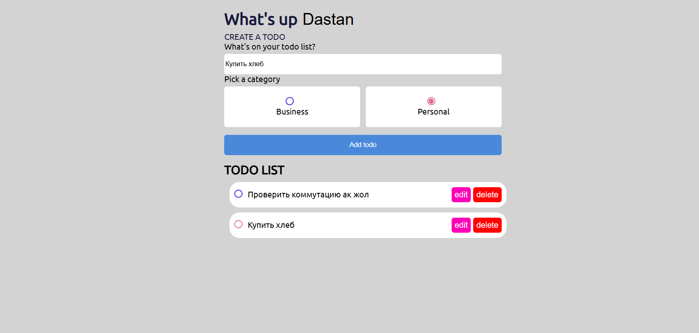

# ✅ neobis_front_todolistReact

**React Todo List Application**

**neobis_front_todolistReact** — пятый Frontend-проект, разработанный в рамках профессиональной стажировки в **Neobis**.

Проект представляет собой простое и удобное приложение для управления повседневными задачами (To-Do List). Пользователь может добавлять задачи, взаимодействовать с ними и организовывать свой список дел.

Основная цель проекта — изучение и закрепление фундаментальных принципов React, освоение компонентного подхода, передачи данных между компонентами и работы с React Hooks.

---

## 📸 Screenshots



---

## ✨ Features

- ➕ **Add Tasks** — добавление новых задач в список.
- 📝 **Task Management** — управление списком задач.
- 🔄 **Dynamic Updates** — обновление интерфейса при изменении состояния.
- ⚛️ **React Components** — разделение приложения на функциональные компоненты.
- 🔗 **Props** — передача данных и функций между компонентами.
- 🎨 **Simple UI** — понятный и удобный пользовательский интерфейс.

---

## 🛠 Tech Stack

| Technology | Purpose |
|---|---|
| React.js | Разработка пользовательского интерфейса |
| JavaScript (ES6+) | Логика приложения |
| React Hooks | Управление состоянием и логикой компонентов |
| JSX | Создание структуры компонентов |
| CSS3 | Стилизация интерфейса |
| HTML5 | Структура приложения |
| npm | Управление зависимостями |

---

## 🏗 React Concepts

В ходе разработки проекта были изучены и применены основные концепции React:

- **Components** — создание и использование функциональных компонентов.
- **Props** — передача данных от родительских компонентов дочерним.
- **Functions as Props** — передача функций между компонентами для обработки пользовательских действий.
- **useState** — управление состоянием компонентов.
- **useEffect** — работа с побочными эффектами.
- **React Hooks** — знакомство с хуками и их использованием в функциональных компонентах.
- **Component Interaction** — организация взаимодействия между компонентами.

---

## 🧠 What I Learned

В процессе разработки я получил практический опыт:

- Создания приложений с использованием React.
- Работы с функциональными компонентами.
- Передачи Props между компонентами.
- Передачи функций через Props.
- Использования React Hooks.
- Управления состоянием приложения.
- Обработки событий и действий пользователя.
- Динамического обновления пользовательского интерфейса.
- Организации структуры React-проекта.

---

## 💻 Installation & Setup

Для локального запуска проекта выполните следующие шаги.

### 1. Clone the repository

```bash
git clone https://github.com/dosymuss/neobis_front_todolistReact.git
```

### 2. Navigate to the project directory

```bash
cd neobis_front_todolistReact
```

### 3. Install dependencies

```bash
npm install
```

### 4. Start the development server

```bash
npm start
```

После запуска приложение будет доступно по адресу:

[http://localhost:3000](http://localhost:3000)

---

## 👨‍💻 About the Project

**Developer:** Дастан Алмазбеков

**Role:** Frontend Developer

**Organization:** Neobis

**Project Number:** 5th Internship Project

**Project Type:** Todo List Application

**Main Focus:** React, Components, Props, Functions, React Hooks

---

## 🔗 Links

- **Live Demo:** [Open Todo List](https://neobis-front-todolist-react-inky.vercel.app/)

---

⭐ Thanks for checking out my project!

This section has moved here: [https://facebook.github.io/create-react-app/docs/deployment](https://facebook.github.io/create-react-app/docs/deployment)

### `npm run build` fails to minify

This section has moved here: [https://facebook.github.io/create-react-app/docs/troubleshooting#npm-run-build-fails-to-minify](https://facebook.github.io/create-react-app/docs/troubleshooting#npm-run-build-fails-to-minify)
